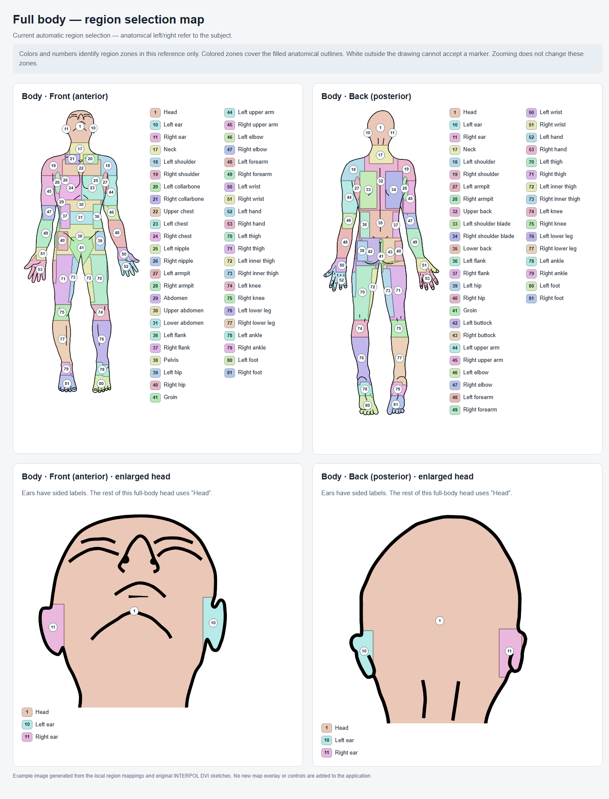
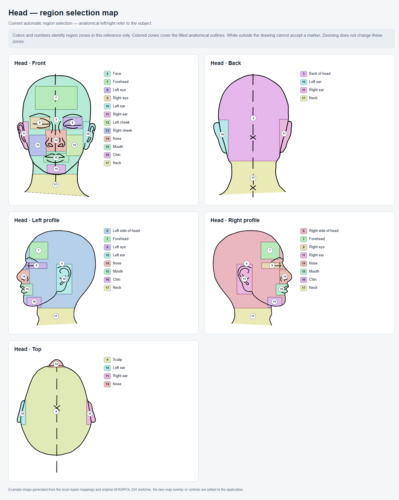
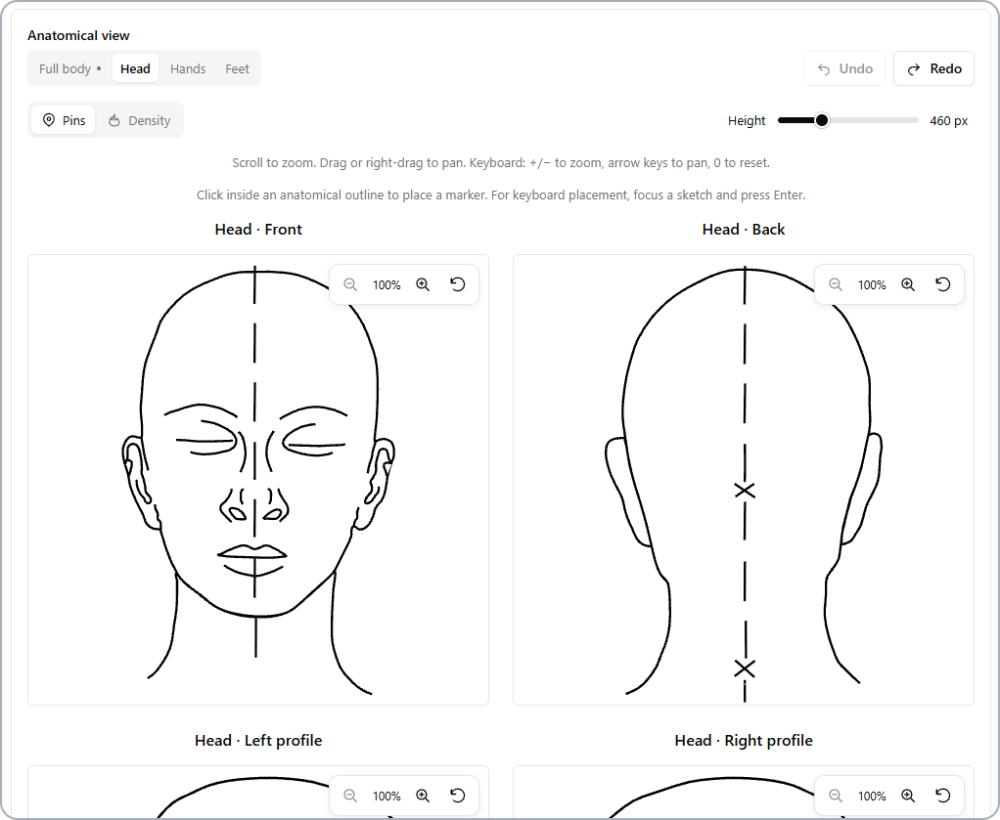
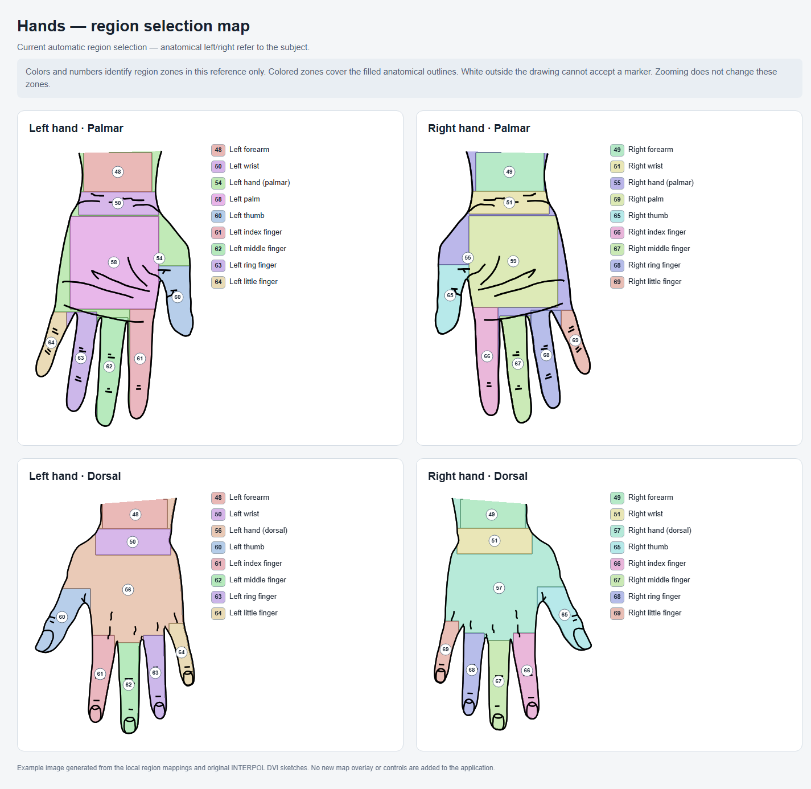
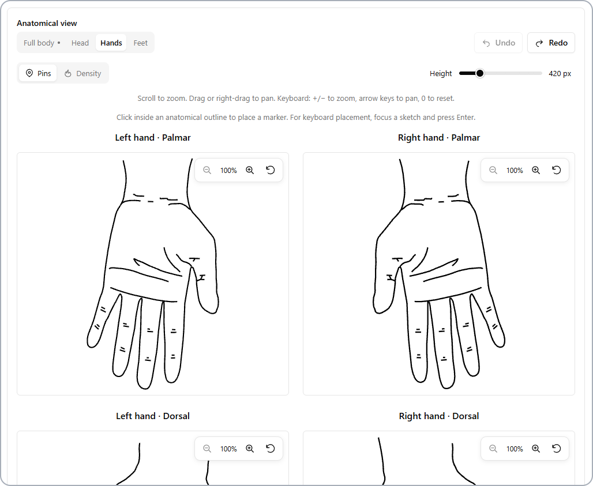
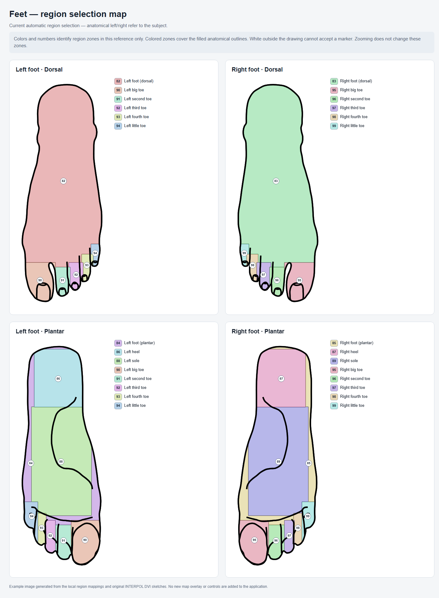
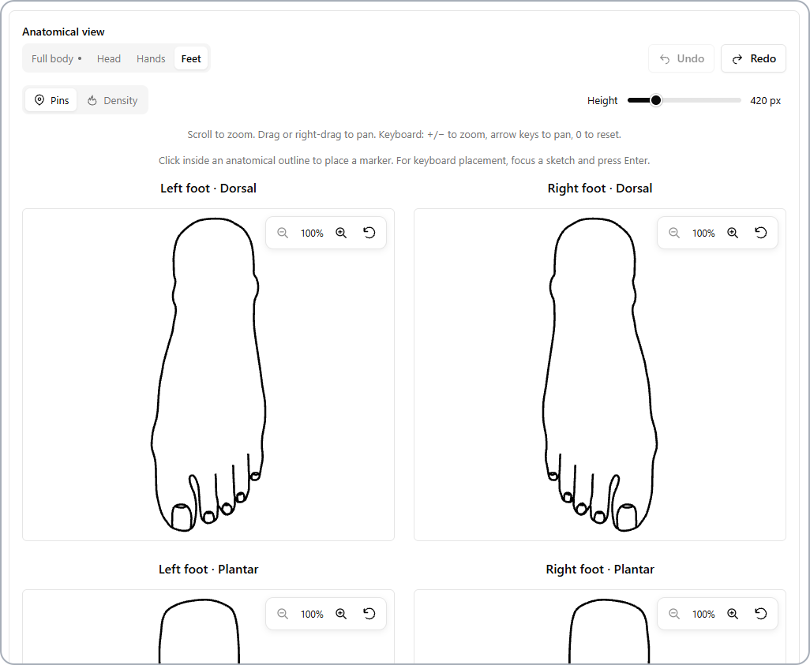

# Body Regions & Selection Maps

[Documentation Index](README.md) · [Package Overview](../README.md)


The package provides **99 standard region choices** through `Enums\BodyRegion` and the frontend catalog. Region suggestions are editable application zones: review the suggested label and refine it for the observation as needed.

## Reading the Maps

- Anatomical left and right always refer to the subject. In the front body view, the subject’s left appears on the viewer’s right.
- Colors distinguish region zones in these reference images. The application’s observation markers use a separate palette based on observation type.
- The numbered keys match the catalog table below for this version. They are illustration labels, not stored region identifiers or observation numbers; catalog changes can change the numbering.
- Specific zones take priority over broader fallback regions. The filled anatomy is covered; surrounding background and spaces between limbs or digits cannot receive new markers.
- Zoom, pan, and viewport height do not change the underlying normalized selection zones.

## Full Body

Front/back body maps include sided ears, shoulders, collarbones, armpits, chest, nipples, back, shoulder blades, pelvis, groin, buttocks, limbs, inner thighs, and feet. The head remains a broader **Head** suggestion in these full-body views; use the detailed head category for facial features. Nipple zones use the front SVG circles with 50% larger radii.



[Open the full-size body map](images/body-regions/full-body.png)

## Head

The five head sketches provide view-specific suggestions for the face, scalp, back and sides of the head, ears, eyes, cheeks, nose, mouth, forehead, chin, and neck. Nostrils suggest **Nose**. Ear rims and lobes are included.



[Open the full-size head map](images/body-regions/head.png)

<p align="center">
    
    <br>
    <sub>The Head tab starts with the front and back sketches. Scroll down for profiles and the top view.</sub>
</p>

## Hands

Palmar and dorsal views distinguish the subject’s left/right hands and fingers. Broader hand, wrist, forearm, and palm labels cover the remaining areas.



[Open the full-size hand map](images/body-regions/hands.png)

<p align="center">
    
    <br>
    <sub>The Hands tab pairs left and right palms above the backs of the hands.</sub>
</p>

## Feet

Dorsal and plantar views identify each sided toe, including its edges. Plantar views also suggest the sole and heel, with broader foot labels covering the remaining anatomy.



[Open the full-size foot map](images/body-regions/feet.png)

<p align="center">
    
    <br>
    <sub>The Feet tab pairs the tops of both feet above the views of the soles.</sub>
</p>

## Region Field Behavior

The Region field offers standard choices in a full-width dropdown styled to
match Type, and accepts custom text. Typing filters the choices; use the arrow
keys and Enter to select, Escape to close, or Tab to keep the current text and
continue. Clicking a recognized area of a sketch suggests a region such as
**Right upper arm**.
Suggestions follow an unsaved marker, including keyboard adjustments, until
you edit the field. Typing a custom value, selecting a standard choice, or
clearing the field preserves that choice through subsequent marker adjustments
and failed saves. Existing saved regions, including blank values, are preserved.

All 15 views cover their filled anatomical outlines. Specific feature zones take
priority, with broader anatomical regions filling the spaces between them.
The SVG surface bounds exclude background and gaps between limbs or digits.
Head and foot zones include ear rims, top-view ears, and toe edges. Nostrils
suggest **Nose**. Nipple zones follow the front SVG circles with 50% larger radii.
Full-body front/back views also distinguish left/right ears, while the remaining
head area retains the broader **Head** suggestion.
Review or refine the text as needed. The body front and back mappings use the
subject's anatomical left and right; detailed head, hand, and foot sketches
have their own mappings.

The catalog includes 99 standard regions, including groin, left/right inner
thighs, nipples, collarbones, armpits, upper chest, and left/right buttocks;
shoulder blades, flanks, hips, elbows, wrists, ankles, palms, soles, and heels;
each finger and toe on both sides; upper/lower abdomen; and facial features
such as eyes, ears, cheeks, nose, mouth, forehead, and chin. Finger and toe
suggestions use the detailed hand and foot views. Broader labels such as
**Face** and **Left hand (palmar)** remain available. The general `Buttocks` enum
case/choice is replaced by `Groin`; left/right buttocks remain separate choices.
Existing saved region text, including `Buttocks`, is preserved when edited.

`BodyRegion` provides standard string values for PHP consumers:

```php
use HumanExaminations\HumanExaminations\Enums\BodyRegion;

$observation->update(['region' => BodyRegion::RightUpperArm->value]);
$observation->update(['region' => BodyRegion::LeftButtock->value]);
$observation->update(['region' => BodyRegion::Groin->value]);
$observation->update(['region' => BodyRegion::RightIndexFinger->value]);
$observation->update(['region' => 'Posterior right upper arm, near elbow']);
```

`region` remains a nullable string, with no enum cast or migration. The Vue
workspace includes the choices by default. For custom interfaces,
`resources/js/observationRegions.js` exports the `bodyRegions` catalog and
`suggestRegion({ sketch_id, x, y })`, which returns a standard label or `null`.
The JSON catalog in `resources/body-regions.json` is checked against the PHP
enum. Suggestions are a frontend convenience; the models and HTTP routes
preserve the region string supplied by the caller.

## JavaScript Lookup

Custom Vue interfaces can use the same catalog and suggestion function:

```js
import {bodyRegions, suggestRegion} from '../../vendor/spawaskar/human-examinations/resources/js/observationRegions.js';

const choices = Object.values(bodyRegions);
const region = suggestRegion({sketch_id: 'body-front', x: 0.23, y: 0.28});
// region === 'Right upper arm'
```

Adjust the import path for the host file's location. The result is a string label
or `null`; placement validation belongs to the sketch component, while the
server accepts the region text supplied by the host.

## Standard Region Catalog

PHP cases are in [`BodyRegion.php`](../src/Enums/BodyRegion.php). The matching frontend keys and labels are in [`body-regions.json`](../resources/body-regions.json). Save the string label in `region`; the reference number is only a map key.

| Map key | Enum case / frontend key | Stored label |
| --- | --- | --- |
| 1 | `Head` | Head |
| 2 | `Face` | Face |
| 3 | `BackOfHead` | Back of head |
| 4 | `Scalp` | Scalp |
| 5 | `LeftSideOfHead` | Left side of head |
| 6 | `RightSideOfHead` | Right side of head |
| 7 | `Forehead` | Forehead |
| 8 | `LeftEye` | Left eye |
| 9 | `RightEye` | Right eye |
| 10 | `LeftEar` | Left ear |
| 11 | `RightEar` | Right ear |
| 12 | `LeftCheek` | Left cheek |
| 13 | `RightCheek` | Right cheek |
| 14 | `Nose` | Nose |
| 15 | `Mouth` | Mouth |
| 16 | `Chin` | Chin |
| 17 | `Neck` | Neck |
| 18 | `LeftShoulder` | Left shoulder |
| 19 | `RightShoulder` | Right shoulder |
| 20 | `LeftCollarbone` | Left collarbone |
| 21 | `RightCollarbone` | Right collarbone |
| 22 | `UpperChest` | Upper chest |
| 23 | `LeftChest` | Left chest |
| 24 | `RightChest` | Right chest |
| 25 | `LeftNipple` | Left nipple |
| 26 | `RightNipple` | Right nipple |
| 27 | `LeftArmpit` | Left armpit |
| 28 | `RightArmpit` | Right armpit |
| 29 | `Abdomen` | Abdomen |
| 30 | `UpperAbdomen` | Upper abdomen |
| 31 | `LowerAbdomen` | Lower abdomen |
| 32 | `UpperBack` | Upper back |
| 33 | `LeftShoulderBlade` | Left shoulder blade |
| 34 | `RightShoulderBlade` | Right shoulder blade |
| 35 | `LowerBack` | Lower back |
| 36 | `LeftFlank` | Left flank |
| 37 | `RightFlank` | Right flank |
| 38 | `Pelvis` | Pelvis |
| 39 | `LeftHip` | Left hip |
| 40 | `RightHip` | Right hip |
| 41 | `Groin` | Groin |
| 42 | `LeftButtock` | Left buttock |
| 43 | `RightButtock` | Right buttock |
| 44 | `LeftUpperArm` | Left upper arm |
| 45 | `RightUpperArm` | Right upper arm |
| 46 | `LeftElbow` | Left elbow |
| 47 | `RightElbow` | Right elbow |
| 48 | `LeftForearm` | Left forearm |
| 49 | `RightForearm` | Right forearm |
| 50 | `LeftWrist` | Left wrist |
| 51 | `RightWrist` | Right wrist |
| 52 | `LeftHand` | Left hand |
| 53 | `RightHand` | Right hand |
| 54 | `LeftHandPalmar` | Left hand (palmar) |
| 55 | `RightHandPalmar` | Right hand (palmar) |
| 56 | `LeftHandDorsal` | Left hand (dorsal) |
| 57 | `RightHandDorsal` | Right hand (dorsal) |
| 58 | `LeftPalm` | Left palm |
| 59 | `RightPalm` | Right palm |
| 60 | `LeftThumb` | Left thumb |
| 61 | `LeftIndexFinger` | Left index finger |
| 62 | `LeftMiddleFinger` | Left middle finger |
| 63 | `LeftRingFinger` | Left ring finger |
| 64 | `LeftLittleFinger` | Left little finger |
| 65 | `RightThumb` | Right thumb |
| 66 | `RightIndexFinger` | Right index finger |
| 67 | `RightMiddleFinger` | Right middle finger |
| 68 | `RightRingFinger` | Right ring finger |
| 69 | `RightLittleFinger` | Right little finger |
| 70 | `LeftThigh` | Left thigh |
| 71 | `RightThigh` | Right thigh |
| 72 | `LeftInnerThigh` | Left inner thigh |
| 73 | `RightInnerThigh` | Right inner thigh |
| 74 | `LeftKnee` | Left knee |
| 75 | `RightKnee` | Right knee |
| 76 | `LeftLowerLeg` | Left lower leg |
| 77 | `RightLowerLeg` | Right lower leg |
| 78 | `LeftAnkle` | Left ankle |
| 79 | `RightAnkle` | Right ankle |
| 80 | `LeftFoot` | Left foot |
| 81 | `RightFoot` | Right foot |
| 82 | `LeftFootDorsal` | Left foot (dorsal) |
| 83 | `RightFootDorsal` | Right foot (dorsal) |
| 84 | `LeftFootPlantar` | Left foot (plantar) |
| 85 | `RightFootPlantar` | Right foot (plantar) |
| 86 | `LeftHeel` | Left heel |
| 87 | `RightHeel` | Right heel |
| 88 | `LeftSole` | Left sole |
| 89 | `RightSole` | Right sole |
| 90 | `LeftBigToe` | Left big toe |
| 91 | `LeftSecondToe` | Left second toe |
| 92 | `LeftThirdToe` | Left third toe |
| 93 | `LeftFourthToe` | Left fourth toe |
| 94 | `LeftLittleToe` | Left little toe |
| 95 | `RightBigToe` | Right big toe |
| 96 | `RightSecondToe` | Right second toe |
| 97 | `RightThirdToe` | Right third toe |
| 98 | `RightFourthToe` | Right fourth toe |
| 99 | `RightLittleToe` | Right little toe |

## Sketch Identifiers

Store stable sketch IDs with normalized coordinates. The [workspace guide](workspace.md#anatomical-views) explains how category selection displays related sketches.

| Category | Stable sketch IDs |
| --- | --- |
| Full body | `body-front`, `body-back` |
| Head | `head-front`, `head-back`, `head-left-profile`, `head-right-profile`, `head-top` |
| Hands | `hand-left-palmar`, `hand-right-palmar`, `hand-left-dorsal`, `hand-right-dorsal` |
| Feet | `foot-left-dorsal`, `foot-right-dorsal`, `foot-left-plantar`, `foot-right-plantar` |

## Maintaining the Reference

1. Keep PHP enum cases and the frontend catalog aligned when changing region choices.
2. Update [`observationRegions.js`](../resources/js/observationRegions.js) when changing semantic selection zones.
3. After changing SVG artwork, run `php scripts/generate-region-surfaces.php` from the repository root to regenerate filled surfaces and nipple landmarks. The generator does not regenerate these PNG images.
4. Refresh all four reference images when zones, artwork, or catalog order change; keep their numbered legends aligned with the catalog table.
5. Run `npm test`, `composer test:unit -- --filter=BodyRegionTest`, and `npm run build` as appropriate for the changes.

See [the SVG Source and Attribution Notes](../resources/sketches/README.md) for artwork provenance, retained permission metadata, and generation tolerances. The illustrations use the package’s original attributed sketches; selection zones and colors are package reference overlays.
