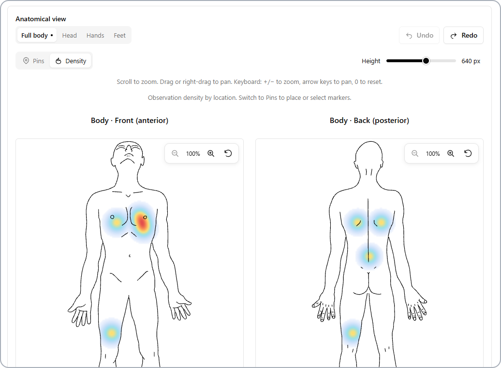
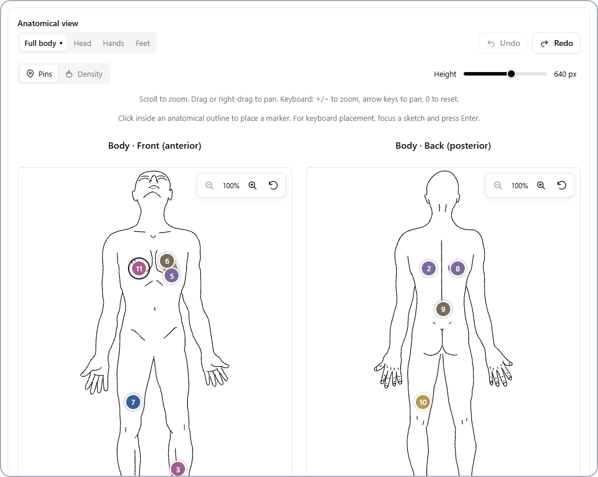

# Workspace Guide

[Documentation index](README.md) · [Package overview](../README.md)

## Getting Started

`resources/js/components/HumanExaminationWorkspace.vue` is a Vue 3.5+ component
for your app's Vite build.

For example, import the component in `resources/js/Pages/Examination.vue`:

```vue
<script setup>
import HumanExaminationWorkspace from '../../../vendor/spawaskar/human-examinations/resources/js/components/HumanExaminationWorkspace.vue';
</script>
```

Adjust the relative path for the location of that page. Pass examination and observation state through the component’s models, or use the persistence callbacks for server-backed observations.

Pass the observation types from Laravel, for example
as an Inertia prop, to show them in the Type dropdown:

```php
use HumanExaminations\HumanExaminations\Models\Observation;

return Inertia::render('Examination', [
    'observationTypes' => array_map(fn ($type) => $type->value, Observation::typeEnum()::cases()),
]);
```

```vue
<HumanExaminationWorkspace v-model:observations="observations" :types="observationTypes" />
```

Without `types`, the Type field is free text.

## Import and Export

The toolbar offers **Import JSON** and an **Export** menu with JSON and CSV options. JSON includes examination details and active observations, including marker locations. Import previews the reference and observation count before confirmation. Local imports replace in-memory workspace data; persistent imports create a new saved examination. Save or cancel an observation draft before transferring files. See [import and export](import-export.md) for the format, host callbacks, and validation behavior.

## Region Suggestions

The editable Region field suggests a standard label from marker placement and accepts custom text. Suggestions follow a new marker until you edit or clear the field; saved region text is preserved. See the [body-region reference](body-regions.md) for the illustrated maps, all 99 choices, PHP/JavaScript examples, and coverage rules.

## Anatomical Views

The workspace's default area includes **Full body**, **Head**, **Hands**, and
**Feet** tabs with responsive SVG diagrams. Body front and back start together,
side by side when there is room and stacked in narrower areas. The catalog offers
15 views:

| Group | Views |
| --- | --- |
| Full body | Front and back |
| Head | Front, back, left profile, right profile, and top |
| Hands | Left/right palmar and dorsal |
| Feet | Left/right dorsal and plantar |

The diagrams preserve their original aspect ratios. The paired body drawings
share the same display height and label the subject's anatomical sides. The
selected tab shows all sketches in that category in two columns when there is
room, stacking in narrow panels. Dots mark categories containing mapped
observations. Arrow Left/Right, Home, and End navigate and select tabs; Tab
continues to the diagram panel. Selecting a mapped observation opens its
category. A host's existing default workspace slot still replaces this area.

For a standalone diagram, import
`resources/js/components/AnatomicalViews.vue` from the installed package into
your Vite build. Its optional `v-model:view` accepts a stable view ID:

```vue
<AnatomicalViews v-model:view="selectedView" />
```

An omitted or unknown ID displays the paired body diagrams. Both `body-front`
and `body-back` select this paired display; each diagram retains its own sketch
ID. Every stable view ID opens its category and displays the other views in that
category too. Choosing a tab emits its first view ID through `v-model:view`
(`body-front`, `head-front`, `hand-left-palmar`, or `foot-left-dorsal`).
The catalog in
`resources/js/sketches.js` exports `sketchGroups` and the flat `sketches` list.
Each view has `id`, `label`, `width`, `height`, and `src`; body views also have
`sides`, ordered from the image's left to right. Store `id` when referring to a
view. Vite builds the source SVGs into local assets and manages their URLs.

## Zoom, Pan, and Diagram Height

Use the **− / +** buttons or scroll over a sketch to zoom from **100% to 500%**.
Each sketch has a small overlay with magnifying-glass zoom buttons, its current
percentage, and a reset button. Scrolling zooms around the pointer in that sketch.
Zoom and pan are independent for each view, so enlarging the front leaves the
back unchanged. Drag with the left or right mouse button to pan. Dragging does
not place or select a marker. **Reset view** restores only that sketch to 100%
and centers it. Changing the anatomical category resets zoom and pan.

The shared **View height** slider resizes all diagram viewports from **280 to 900 px**.
Drawings retain their aspect ratios, paired body views keep the same height,
and marker badges stay the same size. Browser and panel resizing refit the
drawings and constrain panning to keep them reachable.

Focus a viewport to use **+ / −** for zoom, **arrow keys** for pan, and **0** or
**Home** to reset. The draft marker's arrow keys continue to adjust its anatomical
location. Selecting or focusing an off-screen marker brings it into view.
Placement uses the transformed image bounds, so saved coordinates remain
normalized and accurate at any zoom, pan, or viewport size.

## Density View

Switch **Pins / Density** above the diagrams to inspect mapped observation
concentrations. Density replaces numbered pins with a smooth blue-to-red heatmap;
overlapping locations appear warmer. All visible sketches use the same relative
scale, so front/back concentrations can be compared. The scale is recalculated
for the selected category and its observations; it is not an absolute count scale.

<p align="center">
    
    <br>
    <sub>Warmer colors show where mapped observations cluster.</sub>
</p>

Only complete mapped observations contribute. Unmapped findings and the unsaved
marker preview are excluded. Heat is clipped to the anatomical outline, and the
legend reports the mapped count or an empty state. Density represents location
concentration, not observation type or severity.

Zoom, pan, and the shared View height slider work in either mode. Switching modes
preserves framing and draft form values. Density does not place or select markers;
switch to Pins to edit the map. Selecting an observation or starting placement
from the workspace sidebar returns to Pins automatically.

Standalone hosts may use optional `v-model:mode` with `pins` (the default) or
`density`. Mode changes emit `update:mode` and require no additional routes or
database fields.

## Observation Markers

Saved observations appear as numbered markers on their own sketches. Click a
marker or its list entry to select the observation and open its form; selecting
a mapped list entry also opens the corresponding view.

<p align="center">
    
    <br>
    <sub>Pins show each saved observation at its mapped location.</sub>
</p>

Markers and list numbers share a muted color for each observation type. The
palette separates tattoos in deep blue, stab wounds in forest green, and
unspecified findings in neutral gray. Gunshot wounds use deep wine, injuries
use copper, bruises use lavender, and abrasions use ochre.
The **Observation types** legend below the sketches
labels the types used in the examination, including observations on other views
or without locations and the current marker preview. Custom type names get
stable generated colors; missing types use `Unspecified`. Numbers and accessible
type labels remain available alongside color.

With a saved examination, click or tap inside an anatomical outline to start an
observation at that location. The bundled Vue component checks the SVG's filled
anatomy, so surrounding space, gaps between limbs, and spaces between fingers
cannot receive a new marker. An invalid click keeps the current draft unchanged
and displays a warning toast at the bottom-right of the screen. Dismiss it with
its close button; it also disappears after five seconds.
Placement waits for the outline to load; if loading fails, the view shows a retry
message. Observations can still be recorded without markers using **+**.
For an existing observation without a marker, use **Place marker on a
sketch** in the list, then choose a location. Unsaved markers have a dashed
outline and remain previews until you save the observation. A failed save keeps
both the form values and preview; Cancel discards the unsaved location.

To move a saved marker, select it, then click a new location inside an
anatomical outline, or focus the marker and use the arrow keys. Until you save,
the marker appears only as a dashed preview at its new location; Cancel returns
it to its saved location. A region that still matches the suggestion for the old
location changes to the suggestion for the new one; custom or blank regions are
kept. Editing an observation without clicking a sketch preserves its location.

For keyboard placement, focus a sketch and press Enter or Space to place a
preview at its center when that point is on the anatomy, or at an interior
starting point otherwise. The draft marker receives focus. Arrow keys adjust it
by 0.5% of the image; Shift reduces the step to 0.1%. Adjustments that leave the
anatomical outline are rejected. Coordinates are measured against the image
bounds, clamped to the image, and saved with six decimal
places, so markers remain aligned when the diagrams resize or stack.

Standalone `AnatomicalViews.vue` accepts `observations`, `selectedNumber`,
`draftLocation`, `editingNumber`, `placementEnabled` (default false), and
`disabled` props. It emits `place(location)` with `{ sketch_id, x, y }` and
`select(number)`; the host owns the form, selection, and persistence.
`draftLocation` may include a `number` for an existing observation and `type` to
color the preview and include its type in the legend. Persisted markers remain
selectable when placement is disabled, unless `disabled` is true. Incomplete or
invalid locations are not drawn, and observations on other sketches remain in
the list. Set `editingNumber` to the number of a saved observation that is open
for editing to let its marker move: when `draftLocation` has the same `number`,
the saved marker is hidden and only the preview is drawn, and arrow keys on the
saved marker start a preview from its location. Clearing a saved marker remains
follow-up work.

The outline check applies to placing and adjusting drafts in the bundled Vue
component. Models and write routes continue to validate the coordinate tuple
and numeric range, allowing consuming applications to manage their own sketches.

The workspace uses local `v-model:observations` state by default. For server-backed observations, enable `persistent-observations` and wire the save, delete, and restore callbacks described in [application integration](integration.md#observation-persistence).

Original SVG metadata and attribution are retained under `resources/sketches`;
see its [source notes](../resources/sketches/README.md). The supplied artwork
identifies itself as extracted with permission from INTERPOL DVI Form 2023.

## Undo and Redo

**Undo / Redo** reverses the last 50 saved observation additions, edits, removals,
and initial marker placements in the current examination. A new change clears
redo; saving an unchanged observation does not. Text inputs retain native undo.
Controls sit beside the anatomical category tabs, above the shared View height slider.
With focus outside editable fields, use **Ctrl/Cmd+Z** to undo,
**Ctrl/Cmd+Shift+Z** or **Ctrl+Y** to redo.
Shortcuts work across the page when one workspace is mounted; with multiple
workspaces, focus must be inside the intended workspace. Custom workspace slots
keep their history controls in the workspace toolbar. Standalone
`AnatomicalViews.vue` exposes an optional `actions` slot beside its category tabs.

Use **Undo** after clicking **X** to restore an observation and its marker. Use
**Redo** to remove it again. If a form is open for a different observation, undoing
or redoing the removal keeps that draft intact. For other history actions, save
or cancel the open form first. Controls are disabled during requests. Failed
writes keep the history position and can be retried. Switching examinations or
reloading the page starts a fresh history;
examination details, navigation, and unsaved drafts are outside this history.

Local mode updates `v-model:observations`. Persistent mode uses the same save,
delete, and restore callbacks and records changes only after success and the
updated observation list. Undoing a removal restores the original soft-deleted
record with its ID, number, measurements, region, and location. Redoing an undone
creation also restores that record rather than allocating another number.
Hosts must wire `restore-observation` and supply restoration URLs for deleted
records; the workbench demonstrates this. A missing handler reports an unavailable
action without leaving the workspace waiting.

History compares editable fields before replaying a change. If the target differs
from its expected state, history is cleared rather than replacing that state.
This is session-local history, not a multi-user revision log or server-side
optimistic locking.

## Coordinates

See [observation locations](api.md#observation-locations) for storage and model validation.
